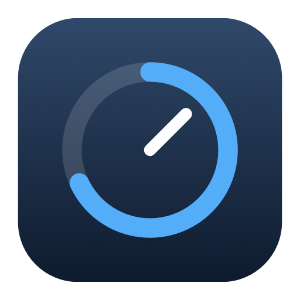

# Gauge

A small native macOS menu bar app for Codex and Claude usage, built with Swift and AppKit. No dependencies, no Dock icon.

- **Usage limits** — 5-hour and weekly usage for Codex and Claude, reset countdowns, and a menu bar progress ring per provider.
- **API cost estimates** — combined token totals and estimated cost for today, 7 days, and 30 days, with a weekly sparkline per provider.
- **Quiet by default** — automatic updates, saved data available offline, and launch at login. **Settings…** toggles each provider and launch at login.

## Build and run

Requires **macOS 13+** and **Xcode**. Codex needs an existing login stored in `~/.codex/auth.json` (or `$CODEX_HOME/auth.json`); Keychain-only Codex logins aren't supported. Claude needs an existing Claude Code login, read from the macOS Keychain or `~/.claude/.credentials.json` (or `$CLAUDE_CONFIG_DIR`).

```sh
./scripts/build.sh
```

Move `build/Gauge.app` to `/Applications`, then open it. Launch at login is configured automatically; you can manage it in macOS **System Settings → General → Login Items**.

The build handles local ad-hoc signing. No Apple Developer account or signing certificate is needed to run it locally. Open `Package.swift` in Xcode to edit the app.

## How it works

Usage limits come from Codex's and Claude's internal usage endpoints using your existing logins. Updates run at launch, roughly once a minute, after waking, or when you click **Refresh**. Opening the menu doesn't trigger a request. Gauge never refreshes tokens itself: if a session expires, use Codex or Claude Code again.

Cost estimates are calculated locally from Codex session logs and Claude Code project logs using [LiteLLM's pricing table](https://github.com/BerriAI/litellm/blob/main/model_prices_and_context_window.json). They represent the API equivalent of your usage, **not a subscription bill**. A `*` marks an estimate with missing model prices.

Only appended log records are processed after the initial scan. The full pricing table stays on disk, with only relevant prices kept in memory. Local state lives in `~/Library/Application Support/Gauge`; conversation contents and credentials aren't stored there, and session logs aren't uploaded.

## Credits

The OpenAI and Claude marks come from [Simple Icons](https://simpleicons.org/) (CC0). Gauge is an independent utility.
